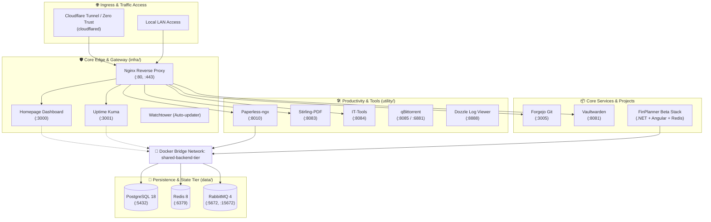

# 🏠 Homelab Infrastructure & Service Orchestration

<p align="center">
  
  
  
  
  
  
  
</p>

A modular, multi-tier self-hosted infrastructure built on Docker Compose. Designed with separated concerns for core networking, shared backend state (relational databases, caches, message queues), day-to-day productivity utilities, internal services, and custom applications.

---

## 📑 Table of Contents

- [Architecture Overview](#-architecture-overview)
- [Repository Structure](#-repository-structure)
- [Port & Service Directory](#-port--service-directory)
- [Prerequisites](#-prerequisites)
- [Quick Start Guide](#-quick-start-guide)
  - [1. Initialize Shared Network](#1-initialize-shared-network)
  - [2. Configure Environment Files](#2-configure-environment-files)
  - [3. Spin Up Stacks (Recommended Order)](#3-spin-up-stacks-recommended-order)
- [Stack Management Commands](#-stack-management-commands)
- [Deploying via Portainer (Recommended GUI Workflow)](#-deploying-via-portainer-recommended-gui-workflow)
- [Networking & Security Hardening](#-networking--security-hardening)
- [Maintenance & Operations](#-maintenance--operations)
- [Troubleshooting & FAQ](#-troubleshooting--faq)

---

## 🏛 Architecture Overview

Services communicate securely through an isolated external bridge network (`shared-backend-tier`), ensuring inter-container reachability without exposing unneeded ports directly to the local LAN or the public internet.



---

## 📂 Repository Structure

```text
homelab-infra/
├── infra/                     # Edge routing, monitoring, & dashboard
│   ├── docker-compose.yml     # Nginx, Homepage, Uptime Kuma, Watchtower
│   ├── .env.example           # Port assignments & timezone settings
│   └── .env
├── data/                      # Core storage engines & message queues
│   ├── docker-compose.yml     # PostgreSQL 18, Redis 8, RabbitMQ 4
│   ├── .env.example           # Database credentials and port overrides
│   └── .env
├── utility/                   # Day-to-day productivity & homelab toolset
│   ├── docker-compose.yml     # Paperless-ngx, Stirling-PDF, IT-Tools, qBittorrent, Dozzle
│   ├── .env.example           # Service ports, PUID/PGID, paperless secrets
│   └── .env
├── core-system/               # Dedicated standalone service deployments
│   ├── cloudflared/           # Cloudflare Zero Trust secure ingress tunnel
│   ├── forgejo/               # Self-hosted Git server + dedicated Postgres
│   ├── uptime-kuma/           # Standalone monitoring deployment option
│   └── vaultwarden/           # Bitwarden-compatible password manager
├── productivity/              # Alternative standalone productivity stacks
│   ├── paperless/             # Self-contained Paperless-ngx stack with local DB
│   └── stirlingpdf/           # Standalone Stirling-PDF OCR deployment
├── projects/                  # Self-hosted development workloads
│   └── finplanner-beta/       # Financial planner app (.NET + Angular + DB specs)
└── README.md                  # System documentation and operational runbook
```

---

## 🔌 Port & Service Directory

| Tier | Service | Container Name | Host Port | Protocol / Path | Purpose |
| :--- | :--- | :--- | :--- | :--- | :--- |
| **Infra** | **Nginx** | `nginx_proxy` | `80`, `443` | HTTP / HTTPS | Reverse proxy & SSL termination |
| **Infra** | **Homepage** | `homepage` | `3000` | Web UI | Application dashboard & service launchpad |
| **Infra** | **Uptime Kuma** | `uptime_kuma` | `3001` | Web UI | High-availability uptime monitoring |
| **Infra** | **Watchtower** | `watchtower` | — | Internal Daemon | Auto-updates containers tagged with `infra-scope` |
| **Data** | **PostgreSQL** | `postgres_db` | `5432` | TCP / PG Wire | Primary multi-tenant relational database |
| **Data** | **Redis** | `redis_cache` | `6379` | TCP / RESP | In-memory key-value cache and worker broker |
| **Data** | **RabbitMQ (App)** | `rabbitmq_broker` | `5672` | AMQP | Message broker for asynchronous workloads |
| **Data** | **RabbitMQ (Mgmt)**| `rabbitmq_broker` | `15672` | Web UI | Real-time queue and exchange monitoring console |
| **Utility** | **Paperless-ngx** | `paperless_ngx` | `8010` | Web UI | Document archiving and OCR ingestion system |
| **Utility** | **Stirling-PDF** | `stirling_pdf` | `8083` | Web UI | Multi-function PDF editor and OCR suite |
| **Utility** | **IT-Tools** | `it_tools` | `8084` | Web UI | Web-based swiss-army knife tools for developers |
| **Utility** | **qBittorrent** | `qbittorrent` | `8085` / `6881` | Web UI / Torrent | Torrent client (Web UI: 8085, Inbound: 6881) |
| **Utility** | **Dozzle** | `dozzle` | `8888` | Web UI | Lightweight, real-time Docker container log viewer |
| **Core** | **Vaultwarden** | `vaultwarden` | `8081` | Web UI / Vault | Self-hosted Bitwarden password manager |
| **Core** | **Forgejo** | `forgejo` | `3005`, `2222` | Web UI / Git SSH | Self-hosted Git forge with Postgres back-end |

> [!NOTE]
> Ports can be customized per stack by modifying the corresponding `.env` file before booting the containers.

---

## ⚙️ Prerequisites

Before launching the infrastructure, ensure your host has:

1. **Docker Engine**: Version `24.0+` or newer.
2. **Docker Compose Plugin**: Version `v2.20+` (invoked via `docker compose`, not `docker-compose`).
3. **User ID & Group ID Permissions**: Recommended standard IDs are `PUID=1000` and `PGID=1000` on Linux hosts.
4. **Git**: To clone and synchronize configurations.

---

## 🚀 Quick Start Guide

### 1. Initialize Shared Network

All interdependent compose stacks bind to a shared external bridge network. **This network must be created once prior to starting any services:**

```bash
docker network create shared-backend-tier
```

Verify that the network exists:
```bash
docker network ls | grep shared-backend-tier
```

---

### 2. Configure Environment Files

Each stack directory contains an `.env.example` file. Duplicate these into `.env` and fill in any secrets or passwords:

#### 🐧 Linux / macOS:
```bash
cp data/.env.example data/.env
cp infra/.env.example infra/.env
cp utility/.env.example utility/.env
```

#### 🪟 Windows (PowerShell):
```powershell
Copy-Item data\.env.example data\.env
Copy-Item infra\.env.example infra\.env
Copy-Item utility\.env.example utility\.env
```

> [!IMPORTANT]
> - Never commit `.env` files to source control! The root `.gitignore` is pre-configured to exclude them.
> - Generate a secure random string for `PAPERLESS_SECRET_KEY` in `utility/.env`.
> - Replace default database credentials in `data/.env` if accessible outside your secure local subnet.

---

### 3. Spin Up Stacks (Recommended Order)

Start the stacks in topological order: **Data Layer first**, followed by **Core Infrastructure**, and finally **Utilities**:

```bash
# Step A: Start Data Backends (Postgres, Redis, RabbitMQ)
docker compose --env-file data/.env -f data/docker-compose.yml up -d

# Step B: Start Core Infrastructure (Nginx, Homepage, Uptime Kuma, Watchtower)
docker compose --env-file infra/.env -f infra/docker-compose.yml up -d

# Step C: Start Utility Applications (Paperless, Stirling-PDF, IT-Tools, etc.)
docker compose --env-file utility/.env -f utility/docker-compose.yml up -d
```

Check health and running status across all stacks:
```bash
docker ps --format "table {{.Names}}\t{{.Status}}\t{{.Ports}}"
```

---

## 🧰 Stack Management Commands

### Starting Stacks

```bash
# Run a specific stack
docker compose --env-file infra/.env -f infra/docker-compose.yml up -d

# Rebuild containers after modifying compose files or Dockerfiles
docker compose --env-file utility/.env -f utility/docker-compose.yml up -d --build
```

### Stopping Stacks

> [!WARNING]
> Do **not** append `-d` to `docker compose down`. The correct syntax is shown below:

```bash
# Stop and remove containers for a specific stack (volumes are preserved)
docker compose -f utility/docker-compose.yml down
docker compose -f infra/docker-compose.yml down
docker compose -f data/docker-compose.yml down
```

### Viewing Logs

```bash
# View aggregated live logs for a specific stack
docker compose -f infra/docker-compose.yml logs -f --tail=100

# View single container logs
docker logs -f paperless_ngx

# Or open Dozzle in your browser at http://<HOST_IP>:8888 for a real-time web UI!
```

### Single-Command Management (Root Helper Scripting)

<details>
<summary><b>Click to expand convenience scripts for Bash & PowerShell</b></summary>

#### Bash One-Liner (Start All):
```bash
for stack in data infra utility; do
  docker compose --env-file ${stack}/.env -f ${stack}/docker-compose.yml up -d
done
```

#### Bash One-Liner (Stop All):
```bash
for stack in utility infra data; do
  docker compose -f ${stack}/docker-compose.yml down
done
```

#### PowerShell One-Liner (Start All):
```powershell
@('data', 'infra', 'utility') | ForEach-Object {
    docker compose --env-file "$_\.env" -f "$_\docker-compose.yml" up -d
}
```

#### PowerShell One-Liner (Stop All):
```powershell
@('utility', 'infra', 'data') | ForEach-Object {
    docker compose -f "$_\docker-compose.yml" down
}
```

</details>

---

## 🐳 Deploying via Portainer (Recommended GUI Workflow)

Deploying through [Portainer CE](https://www.portainer.io/) provides a clean visual dashboard, automatic container restarts, stack health notifications, and Git-driven continuous delivery.

### Option 1: Git Repository Sync (Recommended)

1. Open **Portainer** &rarr; Select your local environment &rarr; Navigate to **Stacks** &rarr; **Add stack**.
2. Select **Repository** build method.
3. Configure the stack:
   - **Repository URL**: `https://github.com/<your-username>/homelab-infra`
   - **Repository reference**: `refs/heads/main`
   - **Compose path**: Set to the target stack file (e.g., `infra/docker-compose.yml` or `data/docker-compose.yml`).
4. **Environment Variables**:
   - Scroll down to the **Environment variables** section.
   - Copy key-value pairs from your local `.env` file into Portainer's editor.
5. Click **Deploy the stack**.
6. Repeat for `data`, `infra`, and `utility`.

> [!TIP]
> Turn on **Automatic updates (Polling or Webhook)** in Portainer to automatically redeploy whenever you push commits to your git repo!

### Option 2: Web Editor Method

1. Create the `shared-backend-tier` network in Portainer under **Networks** &rarr; **Add Network**.
2. Go to **Stacks** &rarr; **Add stack** &rarr; **Web editor**.
3. Paste the contents of `docker-compose.yml`.
4. Paste the corresponding `.env` values into the environment variable section.
5. Deploy.

---

## 🔒 Networking & Security Hardening

1. **Shared Network Isolation**:
   - Containers share the internal bridge network `shared-backend-tier`.
   - Host ports on backend services (like PostgreSQL `5432` or Redis `6379`) can be bound to `127.0.0.1:${POSTGRES_PORT}:5432` in production to prevent exposure outside the host machine.
2. **Reverse Proxy & SSL**:
   - Route external traffic through Nginx or Cloudflare Tunnel (`core-system/cloudflared`).
   - Terminate SSL with valid certificates (Let's Encrypt / Cloudflare Origin CA).
3. **Principle of Least Privilege**:
   - File ownership and user permissions for mounted volumes use non-root UID/GID mapping (`PUID=1000`, `PGID=1000`).
4. **Automated Updates with Watchtower Scope**:
   - Watchtower is restricted by `WATCHTOWER_SCOPE=infra-scope`.
   - Containers are only automatically upgraded if they explicitly declare the label:
     ```yaml
     labels:
       - "com.centurylinklabs.watchtower.scope=infra-scope"
     ```
   - This prevents unintended breaking updates to mission-critical stateful databases.

---

## 🔄 Maintenance & Operations

### Database Backups
- Regularly back up PostgreSQL data directory or dump databases using `pg_dump`:
  ```bash
  docker exec -t postgres_db pg_dumpall -c -U postgres > backup_$(date +%Y%m%d).sql
  ```
- Refer to `projects/finplanner-beta/PostgreSQL/backup-guide.md` for advanced backup automation, `pg_partman`, and `pg_cron` scheduling.

### Pruning Docker Resources
Free up orphaned volumes, dangling build layers, and stopped containers safely:
```bash
docker system prune -a --volumes
```

---

## ❓ Troubleshooting & FAQ

<details>
<summary><b>Error: network shared-backend-tier declared as external, but could not be found</b></summary>
<br/>
Docker Compose cannot find the external network. Create it manually before starting any stack:

```bash
docker network create shared-backend-tier
```
</details>

<details>
<summary><b>Error: Ports already allocated or address already in use</b></summary>
<br/>
Check if a native service or another Docker container is already binding to that port:

```bash
# Linux
sudo ss -tulpn | grep :<PORT>

# Windows PowerShell
Get-NetTCPConnection -LocalPort <PORT>
```
Adjust the colliding port in your `.env` file and redeploy the stack.
</details>

<details>
<summary><b>Paperless-ngx cannot connect to Postgres or Redis</b></summary>
<br/>
1. Ensure the `data` stack is running and healthy: `docker ps | grep postgres_db`
2. Ensure both containers share the `shared-backend-tier` network.
3. Check `PAPERLESS_DB_HOST` in `utility/.env` is set to `postgres_db` (or your database container hostname) rather than `localhost`.
</details>

---

<p align="center">
  <b>Built for reliability, modularity, and zero downtime.</b><br/>
  <sub>Maintained with ❤️ for the self-hosted community.</sub>
</p>
