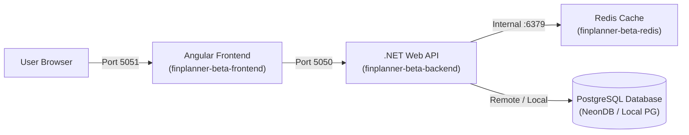

# 💰 FinPlanner Beta Stack (`projects/finplanner-beta`)

<p align="center">
  
  
  
  
</p>

FinPlanner is a full-stack personal finance and budgeting platform featuring automated recurring transaction partitioning, real-time analytics, and caching.

---

## 🏛️ Architecture & Services



| Service | Container Name | Host Port | Role |
| :--- | :--- | :--- | :--- |
| **Frontend** | `finplanner-beta-frontend` | `5051` | Angular client compiled with Nginx |
| **Backend** | `finplanner-beta-backend` | `5050` | ASP.NET Core REST API |
| **Redis** | `finplanner-beta-redis` | Internal | Session state and cache |

---

## ⚙️ Configuration (`.env`)

Create a `.env` file containing database connection strings:
```ini
NEON_DB_CONNECTION="Server=your-server;Database=finplanner;User Id=your-user;Password=your-password;"
```

---

## 🗄️ PostgreSQL Setup with `pg_partman` & `pg_cron`

The subfolder [`PostgreSQL/`](file:///c:/Users/Administrator/Documents/Workspaces/homelab-infra/projects/finplanner-beta/PostgreSQL/README.md) contains Dockerfiles and documentation for building and running an optimized PostgreSQL server with:
- **`pg_partman`**: Automated partition maintenance for high-volume financial transactions.
- **`pg_cron`**: In-database cron scheduling for automated tasks and snapshot summaries.
- See [`PostgreSQL/README.md`](file:///c:/Users/Administrator/Documents/Workspaces/homelab-infra/projects/finplanner-beta/PostgreSQL/README.md) and [`PostgreSQL/backup-guide.md`](file:///c:/Users/Administrator/Documents/Workspaces/homelab-infra/projects/finplanner-beta/PostgreSQL/backup-guide.md) for full instructions.

---

## 🚀 Deployment

```bash
cd projects/finplanner-beta
docker compose up -d
```
- Access the **Web UI**: `http://<HOST_IP>:5051`
- Access the **API / Swagger**: `http://<HOST_IP>:5050/swagger`

